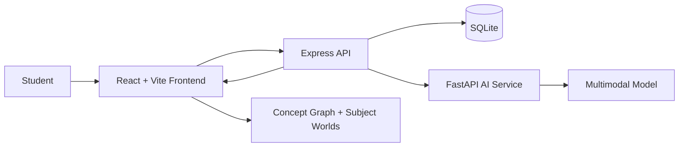

# Cognivanta

> **Turn scattered notes into connected understanding.**

Cognivanta is an AI-powered learning universe that transforms handwritten notes, diagrams, and study documents into structured concept maps, active-recall challenges, and interactive subject worlds.

[](https://nodejs.org/)
[](https://react.dev/)
[](https://www.python.org/)
[](https://fastapi.tiangolo.com/)
[](https://expressjs.com/)
[](https://sqlite.org/)
[](LICENSE)

## The learning loop

Cognivanta connects the parts of studying that are usually scattered across different tools:

1. **Capture** — upload handwritten pages, diagrams, PDFs, or multi-page notes.
2. **Understand** — use multimodal AI to transcribe and structure the material.
3. **Connect** — explore a validated graph of concepts and relationships.
4. **Recall** — answer node-linked questions with explanations and instant feedback.
5. **Explore** — enter Biology, Physics, History, and Geography learning spaces.
6. **Master** — build XP, levels, streaks, activity history, and focused study habits.

## Product highlights

- **AI knowledge extraction:** FastAPI + Pydantic validation for concepts, edges, and quiz references.
- **Concept Matrix:** interactive concept graph with relationship navigation and focused recall.
- **Interactive subject worlds:** game-inspired Biology, Physics, History, and Geography experiences.
- **Focus Sprint:** a persistent 25-minute timer with daily missions, pause/reset controls, and XP rewards.
- **Learning profile:** notes, generated spaces, quiz completions, activity history, streaks, and levels.
- **Secure foundation:** JWT authentication, password hashing, protected user routes, and SQLite persistence.

## Architecture



## Demo

> Watch Cognivanta turn study notes into connected concepts, recall challenges, and interactive learning worlds.

The repository includes a production-ready [demo walkthrough script](docs/DEMO_WALKTHROUGH.md) with a 90–120 second storyboard, voice-over, on-screen captions, recording checklist, and the GitHub video embed format. Upload the final MP4 to GitHub and paste its generated asset URL here:

```md
https://github.com/Rohi56u/COGNI-VANTA/assets/REPLACE_WITH_VIDEO_ASSET_ID
```

The recommended demo flow is: **upload notes → generate a concept graph → inspect relationships → complete active recall → explore a subject world → start a Focus Sprint → review progress**.

## Repository layout

```text
.
├── ai-models/          # FastAPI extraction service and AI prompts
├── backend/             # Express API, auth, uploads, persistence, Swagger
├── frontend/            # React/Vite application and learning worlds
├── design/              # UX flow and product design notes
├── docker-compose.yml   # Local multi-service orchestration
├── PROJECT_MANIFEST.md  # Service inventory
├── PRODUCT_UPGRADE.md   # Product identity and roadmap
└── docs/DEMO_WALKTHROUGH.md # Demo storyboard and recording guide
```

## Quick start

### Requirements

- Node.js 18+
- Python 3.12+
- Google Gemini API key for live extraction
- Docker and Docker Compose are optional

### Configure services

```bash
cp backend/.env.example backend/.env
cp frontend/.env.example frontend/.env
cp ai-models/.env.example ai-models/.env
```

Set `GEMINI_API_KEY` in `ai-models/.env`. For local UI testing without a model key, use the documented mock mode in `backend/.env.example`.

### Start the AI service

```bash
cd ai-models
python3 -m venv .venv
source .venv/bin/activate
pip install -r requirements.txt
uvicorn main:app --host 0.0.0.0 --port 8000 --reload
```

### Start the backend

```bash
cd backend
npm ci
npm run dev
```

The API runs at `http://localhost:3000`. Health check: `GET /api/health`. Swagger UI: `http://localhost:3000/api/docs`.

### Start the frontend

```bash
cd frontend
npm ci
npm run dev
```

Set `VITE_API_URL` in `frontend/.env` to the backend API URL.

### Docker

```bash
export JWT_SECRET="replace-with-a-long-random-secret"
export GEMINI_API_KEY="your-gemini-key"
docker compose up --build
```

## API flow

1. Register or log in through `/api/auth/register` or `/api/auth/login`.
2. Upload files through `/api/upload`.
3. Request `explanation`, `graph`, or `world` generation.
4. Poll the generation job until processing completes.
5. Render concepts, edges, questions, and world data in the frontend.

## Development scripts

| Area | Command | Purpose |
| --- | --- | --- |
| Frontend | `npm run dev` | Start Vite development server |
| Frontend | `npm run build` | Create a production build |
| Frontend | `npm run preview` | Preview the production build |
| Backend | `npm run dev` | Start API with Nodemon |
| Backend | `npm start` | Start the production API |

## Roadmap

- Spaced-repetition scheduling based on question history and confidence.
- Per-concept mastery levels and weak-area recommendations.
- Offline upload queue and full PWA service worker support.
- Teacher/shared-room controls on top of session membership.
- Markdown/PDF export for revision sheets and concept maps.
- Automated tests for extraction validation and learning flows.

## Contributing and security

Issues, feature proposals, documentation improvements, and focused pull requests are welcome. Read [CONTRIBUTING.md](CONTRIBUTING.md) before opening a change.

Never commit `.env` files, API keys, JWT secrets, user uploads, SQLite databases, or generated build output. For security concerns, follow [SECURITY.md](SECURITY.md).

## License

Cognivanta is released under the [MIT License](LICENSE). See the license file for the complete terms.

## Topics

`#AI` `#EdTech` `#ActiveRecall` `#ConceptMapping` `#React` `#FastAPI` `#ExpressJS` `#LearningPlatform` `#GamifiedLearning` `#StudyTools`
